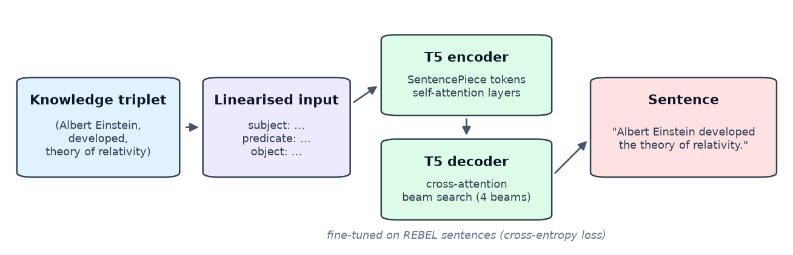

# Natural Language Generation from Knowledge Triplets Using Pre-trained T5 Models

A research project on turning knowledge-graph triplets *(subject, predicate, object)* into fluent English sentences by fine-tuning a T5 encoder–decoder. The repository holds the paper source (LaTeX) and a PyTorch / Hugging Face training and evaluation pipeline.


[](https://github.com/VamsiKrishnaThota03/triple_sentence_generation/actions/workflows/ci.yml)
[](https://github.com/VamsiKrishnaThota03/triple_sentence_generation/actions/workflows/codeql.yml)
[](LICENSE)

**Authors:** Vamsi Krishna, Tejeshwar Rao, Ruthvika Talagampala, Nida Afseen  
*PDPM Indian Institute of Information Technology, Design and Manufacturing, Jabalpur, India*

## Abstract

Generating natural language from structured data is central to report generation, question answering and conversational systems. Template-based systems are reliable but repetitive, while purely neural generators are fluent but can drift from the facts they are given. This work studies a sequence-to-sequence approach in which a pre-trained **T5** model is fine-tuned on triplet–sentence pairs derived from the **REBEL** dataset. Each triplet is linearised into a prompt, and the model learns to produce a sentence that expresses the relation. The paper also outlines a sentence-validation stage (grammar, structure, coherence and semantic checks) and an evaluation protocol based on n-gram and embedding-based metrics.

The full write-up is in [`main.tex`](main.tex) (Elsevier `elsarticle`, Procedia format).

## Method

### Problem formulation

Given a triplet $t = (s, p, o)$, generate a sentence $y$ that is grammatical and faithful to $t$. The task is cast as text-to-text generation:

```
input : "subject: <s> predicate: <p> object: <o>"
target: <reference sentence>
```



### Pipeline in this repository

| Stage | File | What it does |
|-------|------|--------------|
| Data loading | `data_preprocessing.py` | Streams REBEL from the Hugging Face Hub (the Parquet conversion of `Babelscape/rebel-dataset`, so no dataset script is needed), parses its linearised `<triplet> … <subj> … <obj> …` field into *(subject, predicate, object)*, and keeps sentences that express exactly one triplet (`--all-triplets` keeps the first triplet of every sentence). Spacing such as `Paris , France` is normalised. A local CSV/JSON(L) can be used instead. |
| Cleaning | `DataPreprocessor.clean_data()` | Checks for `subject` / `predicate` / `object` / `text`, drops empty and duplicate rows, makes a shuffled 80/20 train/validation split (seed 42) |
| Dataset | `model.py` → `TripletDataset` | Linearises each triplet and tokenises inputs and targets (max 128 tokens each); batches are padded dynamically and padding is masked out of the loss |
| Model | `model.py` → `TripletToSentenceModel` | Any seq2seq checkpoint (`t5-small` by default). Uses CUDA, Apple-Silicon MPS or CPU. |
| Training | `model.py` → `train()` | Hugging Face `Trainer` with weight decay 0.01 and warm-up. Evaluates and checkpoints every epoch, keeps the best model by validation loss and saves it to `--output-dir` |
| Decoding | `model.py` → `generate_batch()` | Batched beam search (4 beams), up to 50 new tokens, `length_penalty=0.6` |
| Evaluation | `evaluation.py` → `ModelEvaluator` | Corpus BLEU (sacreBLEU), ROUGE-1/2/L F1, token-overlap precision/recall/F1 and, unless `--no-bertscore`, **BERTScore** P/R/F1 (baseline-rescaled) |
| Driver | `main.py` | Data → train → evaluate on the validation split → writes `metrics.json` and `predictions.jsonl` → prints example generations |

### Paper vs. code

`main.py --preset` picks the hyper-parameters. Flags such as `--epochs` override a preset.

| | `--preset code` (default) | `--preset paper` (as in `main.tex`) |
|---|---|---|
| Model | `t5-small` | `t5-base` |
| Epochs | 10 | 3 |
| Batch size | 64 | 8 |
| Learning rate | 5e-5 | 2e-5 |

Still described in the paper but **not** implemented here: the LanguageTool-based sentence validator with its improve-and-retry loop, grammar-error counts, the "overall quality score" and the template-based baseline. The results table in the paper therefore can't be reproduced from this code.

## Repository structure

```
triple_sentence_generation/
├── main.tex                    # Paper source (elsarticle / Procedia)
├── references.bib              # Bibliography for main.tex
├── t5_architecture.png         # Figure 1 (generated by scripts/make_architecture_figure.py)
├── main.py                     # CLI driver: data → train → evaluate → examples
├── data_preprocessing.py       # REBEL streaming/parsing, local files, cleaning, split
├── model.py                    # TripletDataset + T5 fine-tuning and generation
├── evaluation.py               # BLEU, ROUGE, token overlap, BERTScore
├── test_pipeline.py            # Fast tests (no model downloads)
├── examples/sample_triplets.csv  # 32 hand-written triplet/sentence pairs for smoke runs
├── scripts/make_architecture_figure.py
├── requirements.txt
└── LICENSE                     # MIT
```

## Running the code

### Requirements

- Python 3.10+
- A CUDA GPU is recommended for real fine-tuning runs; CPU and Apple-Silicon MPS work for small experiments
- Internet access on first run, to download the model, REBEL rows and (optionally) the BERTScore model (`roberta-large`, about 1.4 GB)

### Setup

```bash
git clone https://github.com/VamsiKrishnaThota03/triple_sentence_generation.git
cd triple_sentence_generation

python -m venv venv
source venv/bin/activate          # Windows: venv\Scripts\activate
pip install -r requirements.txt
```

### Quick smoke run (a few minutes on a laptop)

```bash
python main.py --data examples/sample_triplets.csv --model t5-small \
    --max-steps 40 --batch-size 8 --learning-rate 3e-4 --warmup-steps 0 --no-bertscore
```

### Train and evaluate on REBEL

```bash
python main.py --max-samples 50000                    # code defaults (t5-small, 10 epochs)
python main.py --preset paper --max-samples 50000     # t5-base, 3 epochs, batch 8, lr 2e-5
python main.py --help                                 # all options
```

REBEL has about 3 million training sentences, so `--max-samples` is the practical way to size a run. The model, tokenizer, `metrics.json` and `predictions.jsonl` are written to `./t5_triplet_model` (`--output-dir`).

Local data needs `subject`, `predicate`, `object` and `text` columns (`.csv`, `.json` or `.jsonl`): `python main.py --data my_pairs.csv`.

### Use a trained model

```python
from model import TripletToSentenceModel

m = TripletToSentenceModel(model_name="./t5_triplet_model")
print(m.generate_sentence("William Shakespeare", "wrote", "Hamlet"))
print(m.generate_batch([("Paris", "capital of", "France"), ("Python", "developer", "Guido van Rossum")]))
```

### Tests

```bash
python -m unittest -v test_pipeline
```

## Building the paper

The paper uses Elsevier's `elsarticle` class, which ships with TeX Live and MiKTeX. All inputs (`references.bib`, `t5_architecture.png`) are in the repository.

```bash
latexmk -pdf main.tex
# or: pdflatex main.tex && bibtex main && pdflatex main.tex && pdflatex main.tex
# or: tectonic main.tex
```

To regenerate the figure: `python scripts/make_architecture_figure.py`. You can also upload `main.tex`, `references.bib` and the figure to Overleaf.

## Limitations

- Evaluation uses a validation split carved out of the REBEL training split; REBEL's own validation/test splits are not used yet.
- REBEL sentences often mention more than the single triplet they are paired with, so references contain extra facts the model can't know. Scores are therefore lower than on clean data-to-text corpora such as WebNLG.
- The sentence-validation stage and template baseline described in the paper are not implemented (see *Paper vs. code*).

## Acknowledgements

- **REBEL** dataset: Huguet Cabot & Navigli, 2021 — [Babelscape/rebel-dataset](https://huggingface.co/datasets/Babelscape/rebel-dataset)
- **T5**: Raffel et al., 2020 — [google-research/text-to-text-transfer-transformer](https://github.com/google-research/text-to-text-transfer-transformer)
- **BERTScore**: Zhang et al., 2020 — [Tiiiger/bert_score](https://github.com/Tiiiger/bert_score)
- Hugging Face [Transformers](https://github.com/huggingface/transformers) and [Datasets](https://github.com/huggingface/datasets)

## License

Released under the [MIT License](LICENSE).


## Tests and CI

```bash
pip install -r requirements-dev.txt
python -m unittest -v test_pipeline     # 8 tests, a few seconds
```

`data_preprocessing.py` and `evaluation.py` import torch, transformers and
bert-score **lazily**, inside the functions that need them. That is a useful
property, and `requirements-dev.txt` exists to exploit it: the fast suite — REBEL
linearisation parsing, the single-triplet filter, detokenisation, the local-CSV
split, and BLEU/ROUGE/token-overlap — needs only pandas, sacrebleu and
rouge-score. CI therefore completes in seconds instead of after a
multi-gigabyte torch download.

| Job | What it proves |
| --- | --- |
| `test` (Python 3.11, 3.12) | The 8 fast tests on the minimal dependency set, **plus** an explicit check that torch, transformers, bert-score, accelerate and datasets are *not* installed. If someone moves a heavy import to module level, that fails with a message naming the cause instead of a confusing `ImportError` in an unrelated test |
| `imports` | Installs the full `requirements.txt` and imports every module, including the training path the fast job cannot reach, and runs `main.py --help` to confirm the CLI is usable without downloading a model |

BERTScore is the one metric that genuinely needs torch, and the suite skips it
rather than pretending to cover it.

CodeQL runs over Python weekly; Dependabot watches pip and Actions.
